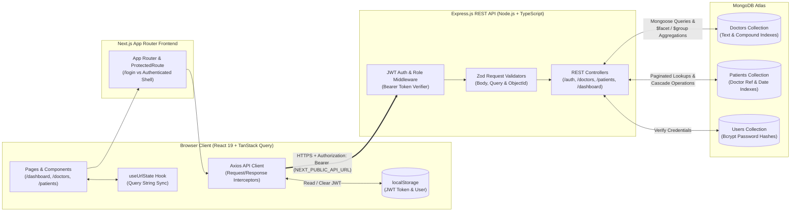
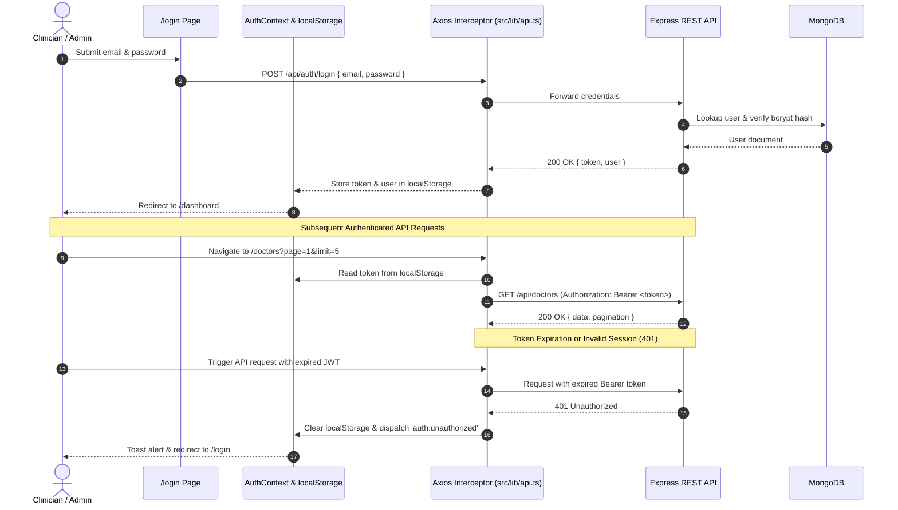

# Doctor Tracker Web (`doctor-tracker-web`)

## 1) Elevator Pitch

**Doctor Tracker Web** is a full-featured clinical operations and patient census management frontend engineered with Next.js (App Router, TypeScript), TanStack Query, Tailwind CSS, and Recharts that connects to a standalone Express and MongoDB REST API. Designed for hospital administrators and attending physicians, it streamlines day-to-day clinical workflows by unifying real-time physician directories, nested doctor-to-patient rosters, debounced multi-attribute filtering with URL-synchronized state, and interactive time-series analytics into a responsive, keyboard-accessible workspace that scales effortlessly from mobile bedside tablets (`375px`) to widescreen command centers (`1280px+`).

---

## 2) Setup Guide

Follow these step-by-step instructions to install and run the frontend locally:

### Prerequisites
- **Node.js**: `v20.x` or later
- **npm**: `v10.x` or later
- Access to a running instance of the **Doctor Tracker Backend REST API** (local or hosted)

### Step-by-Step Local Installation

1. **Clone the repository and navigate to the project directory:**
   ```bash
   git clone <repository-url>
   cd doctor-tracker-web
   ```

2. **Install dependencies:**
   ```bash
   npm install
   ```

3. **Configure environment variables from `.env.example`:**
   Copy the provided `.env.example` template to `.env.local` (or `.env`):
   ```bash
   cp .env.example .env.local
   ```
   Open `.env.local` and verify `NEXT_PUBLIC_API_URL` points to your backend REST API:
   ```env
   # NEXT_PUBLIC_API_URL: Base URL for the external Doctor Tracker REST API.
   NEXT_PUBLIC_API_URL="https://doctor-tracker-backend-care-guide.vercel.app/"
   ```
   *(For local backend development on port 4000, set `NEXT_PUBLIC_API_URL="http://localhost:4000/api"`.)*

4. **Start the development server:**
   ```bash
   npm run dev
   ```
   The application will start on `http://localhost:3000`.

5. **Run type-checking and production build verification:**
   ```bash
   npm run lint
   npm run build
   ```

---

## 3) System Architecture

The system follows a decoupled client-server architecture where the Next.js TypeScript frontend communicates exclusively with the external Express REST API over HTTPS using JSON payloads and stateless JWT Bearer authentication.

### High-Level Architecture & Authentication Flow



### Authentication Lifecycle (`POST /api/auth/login` → Protected Requests → `401` Recovery)



---

## 4) Technical Decisions

### Deep Dive 1: Why JWT Bearer Tokens (`Authorization: Bearer <token>`) vs. `httpOnly` Cookies

When architecting authentication for a decoupled frontend (`doctor-tracker-web`) talking to an independently deployed REST API (`doctor-tracker-backend`), we chose **stateless JWT Bearer tokens attached via an Axios request interceptor** over `httpOnly` cookies for the following reasons:

1. **Cross-Origin Deployment Independence (CORS & Third-Party Cookie Restrictions):**
   The Next.js frontend and the Express API are hosted on separate origins/subdomains (and can be consumed by mobile or third-party clinical clients). Modern browsers (Safari ITP, Brave, Chrome third-party cookie phase-out) aggressively block cross-site cookies even with `SameSite=None; Secure`, unless both services share a parent registrable domain or route through a reverse proxy. Explicit `Authorization: Bearer <token>` headers work deterministically across any origin boundary with standard CORS headers (`Access-Control-Allow-Headers: Authorization, Content-Type`).
2. **Elimination of CSRF Attack Surface:**
   Because browsers automatically attach cookies to every matching origin request, `httpOnly` cookie authentication requires synchronizer tokens or double-submit cookie patterns to defend against Cross-Site Request Forgery (CSRF). By storing the JWT in `localStorage` and injecting it explicitly via Axios (`config.headers.Authorization = 'Bearer ' + token`), forged cross-origin requests from external sites cannot attach the header, eliminating CSRF vectors by design.
3. **Centralized Client-Side Lifecycle & Instant 401 Interception:**
   Using a single Axios instance (`src/lib/api.ts`) paired with `AuthContext` (`src/lib/auth-context.tsx`) gives deterministic control over session state:
   - Every outgoing request automatically attaches the token without duplicating auth logic across components.
   - If the backend responds with `401 Unauthorized` (expired or revoked token), the Axios response interceptor immediately purges `localStorage`, emits an `auth:unauthorized` event, and redirects the clinician to `/login`.

### Deep Dive 2: Why Server-Side Pagination with MongoDB Indexes and Aggregation Pipelines

Rather than fetching entire collections into browser memory and filtering client-side, all directory views (`/doctors`, `/doctors/[id]`, `/patients`) and analytics (`/dashboard`) rely on **server-side pagination, compound MongoDB indexes, and aggregation pipelines**:

1. **Bounded Payload Size & Sub-100ms Query Latency at Scale:**
   In a real clinical environment, patient rosters grow to tens or hundreds of thousands of records. Fetching all records to the browser causes multi-megabyte JSON payloads, main-thread garbage collection stalls, and sluggish mobile rendering. By passing URL-synced query parameters (`page`, `limit`, `search`, `specialization`, `hospital`, `condition`, `doctorId`, `from`, `to`) to the backend and pairing them with TanStack Query's `placeholderData: keepPreviousData`, the client only ever transfers and renders 5–20 rows at a time while keeping page transitions instantaneous.
2. **Compound & Text Indexing in MongoDB:**
   Server-side filtering is backed by targeted MongoDB indexes on the `Doctor` and `Patient` collections:
   - Weighted text indexes (`name`, `email`, `specialization`, `hospital`, `condition`) and regex prefix matching power the 300ms debounced search bar without full collection scans (`COLLSCAN`).
   - Compound indexes on `(specialization, hospital, createdAt)` for doctors and `(doctor, condition, createdAt)` for patients allow MongoDB's query planner to satisfy filter + sort + `skip`/`limit` operations directly from index keys (`IXSCAN`).
3. **Single-Roundtrip Analytics via MongoDB Aggregation Pipelines (`GET /api/dashboard/stats`):**
   Computing dashboard metrics (Total Doctors, Total Patients, New This Week, Patients per Doctor, Patients Over Time, Condition Breakdown, and Doctors Added per Week) on the client would require downloading every doctor and patient document. Instead, the backend executes parallel `$match`, `$group`, `$lookup`, and `$sort` aggregation pipelines inside MongoDB and zero-fills missing dates for the selected `7` / `30` / `90` day window. The frontend receives a compact, pre-aggregated JSON payload ready for memoized Recharts components.

---

## 5) Visual Evidence

### Desktop Views (`1280px`)

| View | Screenshot Placeholder |
| :--- | :--- |
| **Login (`/login`)** |  |
| **Analytics Dashboard (`/dashboard`)** |  |
| **Doctors Directory (`/doctors`)** |  |
| **Doctor Detail & Roster (`/doctors/[id]`)** |  |
| **Patients Directory (`/patients`)** |  |

### Mobile Views (`375px`)

| View | Screenshot Placeholder |
| :--- | :--- |
| **Mobile Slide-In Navigation Drawer** |  |
| **Mobile Dashboard & Charts (`375px`)** |  |
| **Mobile Stacked Doctor Cards (`375px`)** |  |
| **Mobile Stacked Patient Cards (`375px`)** |  |

---

## 6) Demo Credentials

Use the following pre-seeded administrator credentials on the `/login` page to access all protected routes and CRUD operations:

- **Email:** `admin@doctortracker.com`
- **Password:** `Admin@12345`

*(Tip: You can also click the **"Fill Attending Login"** button on `/login` to populate these credentials automatically.)*

---

## 7) Live URLs

- **Frontend Application (Shared Preview URL):** [https://ais-pre-nlmrrqnafkjjvexd6jcofq-9714675795.asia-southeast1.run.app](https://ais-pre-nlmrrqnafkjjvexd6jcofq-9714675795.asia-southeast1.run.app)
- **Frontend Application (Development URL):** [https://ais-dev-nlmrrqnafkjjvexd6jcofq-9714675795.asia-southeast1.run.app](https://ais-dev-nlmrrqnafkjjvexd6jcofq-9714675795.asia-southeast1.run.app)
- **Backend REST API URL:** [https://doctor-tracker-backend-care-guide.vercel.app/](https://doctor-tracker-backend-care-guide.vercel.app/)
- **Backend API Base Endpoint (`NEXT_PUBLIC_API_URL`):** `https://doctor-tracker-backend-care-guide.vercel.app/api`
